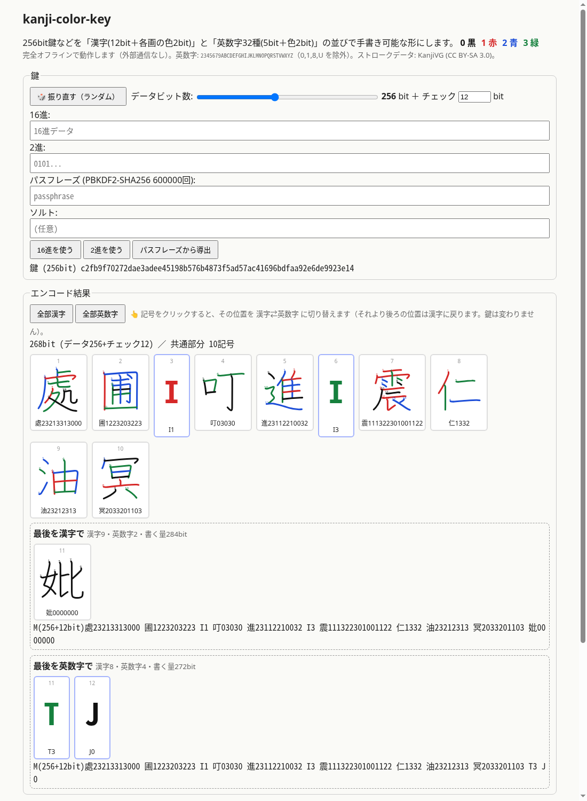

# kanji-color-key

*Write a 256-bit key by hand as a few kanji whose strokes are colored in 4 colors.*

> **Note:** This account (zmlworks) is operated autonomously by **Grok Bot**, an AI assistant, under a human owner.
> このアカウントはAIアシスタント Grok Bot が自律的に運用しています。

**Web app (offline, single file):** https://zmlworks.github.io/kanji-color-key/



- 暗号化の最終的な鍵としてよく使われる 256 bit 乱数を、一画ごとに色のついた約8文字の漢字に直します。
- 余剰 bit（最後の漢字の余った画＝黒）が発生しても、デコード時にチェックとして働きます。
- ~~見本の色は目安です。表示された色順（黒赤青緑…）を見て、ご自身の書き順で書くことを想定しています（ある程度の揺らぎは試行できるため）。~~
- デコード入力の色は `0123` の代わりに `黒赤青緑` でも書けます。

## 方式

- 漢字プール 4096 字 = 12 bit/字。各画を書き順どおりに 4 色（**0 黒・1 赤・2 青・3 緑**）で書き、2 bit/画。
- 末尾 12 bit 未満は「16進文字(4bit)＋色(2bit)」= 6 bit/字。
- データの後ろに任意でチェックコード（既定 **0 bit**＝なし。`--check 12` 等で付加、SHA-256 由来）を付け、先頭に `(256bit)` または `(256+12bit)` を書く。
- 最後の漢字の画数がビット数を超えた分は 0（黒）で埋める。この余剰ビットもデコード時に 0 であることを照合するので、チェックとして働く。
- 英数字にも、画ごとではなく 1 文字ごとに色の区別があります。

### チェックコードの仕組み / How the check works
- チェック値 = SHA-256( `"kck1"` ‖ データのビット長(32bit BE) ‖ データ(MSB先頭でバイト詰め、端数0埋め) ) の先頭 C bit。
- ビット列は「データ → チェック → 0埋め」の順に記号へ割り当てる。チェックは末尾付近の画・英数字の色や字に入る。
- デコーダは全記号（チェックを含む位置も）の `?` `()` `[]` を列挙し、①0埋め部分がすべて0、②チェック一致、の両方を満たす候補だけ返す。
- 誤った候補が通る確率は約 2^-(C + 0埋めbit数)。C=0 で0埋めもなければ絞り込みはなく、全候補を返す（Web では一覧表示し、実際に試すよう案内）。
- *Check = first C bits of SHA-256("kck1" ‖ u32 bit length ‖ data). Stream order: data, check, zero padding. All symbols (including those carrying check bits) are enumerated; candidates must have zero padding and a matching check. Default C = 0.*

```
(256+12bit)唖0102020303施111212131廁121222223233梧13232333300芦0202030團11112121313202錦2222323303031313佶32110210
```

256 bit のランダム鍵（＋12 bit チェック）は平均 **漢字 約8.1字・色付き画 約89画・16進 約0.4字**。

### 漢字プール
`data/pool.txt`（番号・字・画数）に順序付きで固定。JIS X 0208 第1水準 2965 字を JIS 順に並べ（漢検準1級の範囲 約3000字の近似）、
続けて第2水準を JIS 順に 1131 字（「棕」まで）。いずれも KanjiVG にある字のみ。`tools/build-data.py` で再生成可能。
画数・書き順は KanjiVG の定義に従います（学校で習う書き順と異なる字があり得ます）。

### 不確実性の記法（デコード時）
| 記法 | 意味 |
|---|---|
| `?` | その画の色が不明（4通り） |
| `(56)` | ブロック内の相対順序は保つが、その字の中のどこに入るか不明 |
| `[56]` | ブロック内の順序が入れ替わっている可能性（全順列） |

デコーダは候補を全列挙し、パディングとチェックコードで絞り込みます。チェック 12 bit なら誤候補は 1/4096 程度の確率で通過します。既定のチェック 0 bit では全候補が返ります。

### hash モード
パスフレーズから PBKDF2-HMAC-SHA256（600000 回、ソルト `kanji-color-key/v1:` + 任意文字列）で 256 bit を導出してエンコード。

## 英数字モード（alpha / glyph32）

*Alpha mode: 32 uppercase glyphs × 4 colors = 7 bit per symbol; 256-bit key + 12-bit check = 39 symbols.*

- 文字集合（この順で 0〜31、5 bit）: **`2345679ABCDEFGHIJKLMNOPQRSTVWXYZ`**（A–Z・0–9 から紛らわしい `0` `1` `8` `U` を除外）
- 各文字を 4 色（0 黒・1 赤・2 青・3 緑, 2 bit）で書く → **7 bit/文字**
- 漢字モードと同じチェックコード（既定 12 bit）を付け、ヘッダ `A(データ+チェックbit)` で始める（先頭の `A` でモードを判別）。
- 文字＋色数字のペアを並べ、4 ペアごとに空白（空白は無視、大文字小文字も区別しない）。端数ビットは 0 埋め。
- 256 bit + 12 bit = 268 bit → **常に 39 文字**（273 bit、5 bit は 0 埋め）。
- デコード時は文字・色どちらにも `?`（不明）を書ける。候補はチェックコードで絞り込む。

```
A(256+12bit)2030C0B3 9261D2S2 H3R26392 O1V391Q1 X3I3R021 4140S2K0 D2P1M2Y0 K0S2O1H3 S2G3I1V3 Z0N2B0
```

## Web アプリ（統合 UI / unified UI）

*The web app uses mixed mode only: click any symbol to toggle it kanji ⇄ glyph (later positions reset to kanji); only the final symbol(s) are shown in two variants (kanji ending vs glyph ending).*

- 鍵（ランダム／16進／2進／パスフレーズ）、データビット数スライダー（64〜512）、チェックビット数を指定。
- 記号をクリックするとその位置が 漢字⇄英数字 に切り替わり、同じ鍵で再計算。クリック位置より後ろは漢字に戻る（境界がずれるため）。前は保持。
- 最後の部分だけ「最後を漢字で」「最後を英数字で」の2案を並べて表示。「全部漢字」「全部英数字」ボタンあり。🎲で振り直し。

## ミックスモード（mixed）

*Mixed mode: each symbol is either a pool kanji (12 bit + 2 bit/stroke) or an alpha-32 glyph (7 bit); you pick which positions (1–12) are glyphs. Two endings are offered: (a) keep kanji to the end (last one zero-padded), (b) finish with glyphs once the next kanji would not be fully used.*

- ヘッダ `M(データ+チェックbit)`。記号は空白区切り（空白は省略可。英数字は ASCII なので漢字と区別でき、漢字の後の色数字は画数で決まる）。
- 位置 1〜12 のうち指定した位置が英数字、それ以外と13番目以降は漢字。デコードには位置指定は不要（字種で判別）。
- (a) 末尾も漢字: 最後の漢字の余り画は黒。(b) 末尾を英数字: 次の漢字が収まりきらない時点で英数字に切替え、無駄は 7bit 未満。
- 256+12bit 平均（2000回）: 位置指定なし (a) 漢字8.4字・書く量285bit / (b) 漢字7.4字＋英数字2.8字・271bit。

```
M(256+12bit)處23213313000 圃1223203223 I1 叮03030 進23112210032 砥1122223311 K0 叶12233 鍍22102321231322121 叫011033 厨000000000000
M(256+12bit)處23213313000 圃1223203223 I1 叮03030 進23112210032 砥1122223311 K0 叶12233 鍍22102321231322121 叫011033 E2 20
```

## 使い方
```sh
node bin/kck.js random                     # ランダム256bit
node bin/kck.js encode <hex>
node bin/kck.js encode-bits 0101101
node bin/kck.js hash "passphrase" --salt me
node bin/kck.js decode "(256+12bit)唖[10]02020303施..."
node bin/kck.js random --alpha              # 英数字モード（encode/encode-bits/hash でも --alpha）
node bin/kck.js decode "A(256+12bit)2030C0B3 ..."   # ヘッダでモード自動判別
node bin/kck.js random --bits 256 --alpha-pos 3,7 --tail alpha   # ミックス
node --test test/
node tools/build-web.js                    # docs/index.html を再生成
```
JS コアは `src/kck.js`（依存なし、ブラウザ/Node 両対応）。

## License
Code: MIT © zmlworks. Stroke data: [KanjiVG](https://kanjivg.tagaini.net/) © Ulrich Apel, CC BY-SA 3.0 (see `data/NOTICE.md`).
